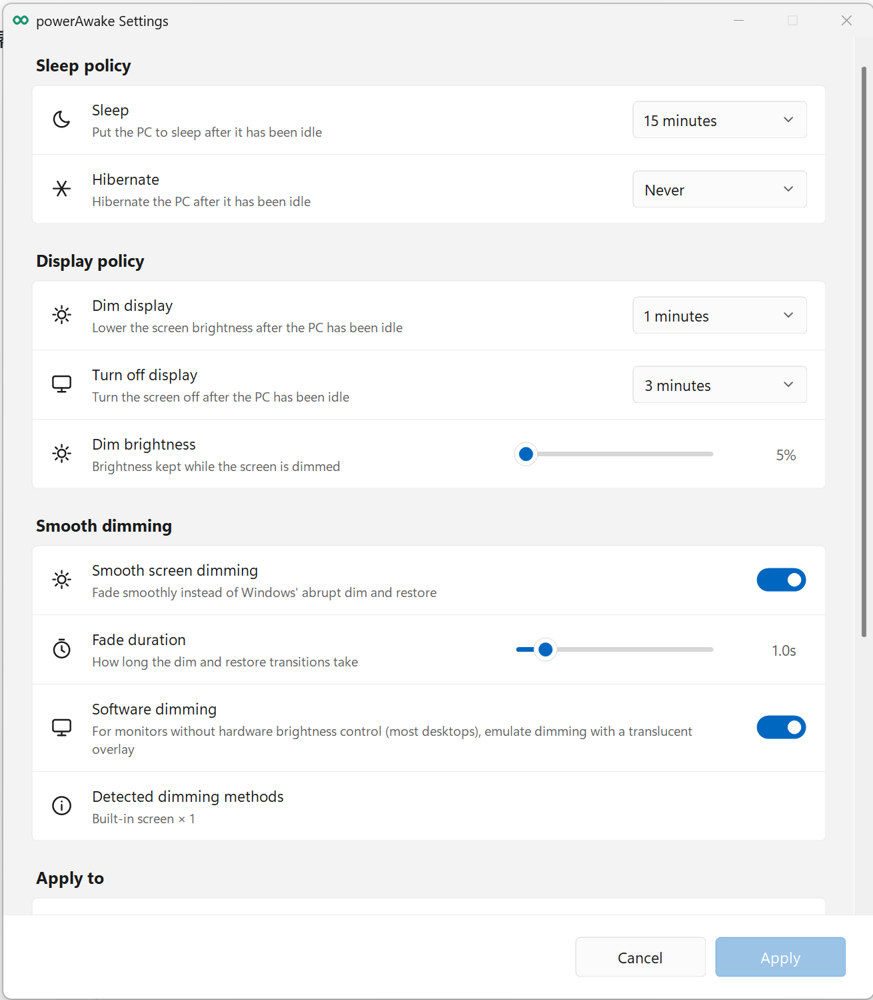

  

<h1 align="center">PowerAwake</h1>

PowerAwake 是一款轻量级 Windows 11 防休眠工具，让电脑在运行 AI 任务、下载文件或执行长时间作业时持续工作，并可按需保持屏幕常亮。

PowerAwake is a lightweight Windows 11 utility that keeps your PC awake for AI tasks, downloads and other long-running work, with an option to keep the screen on.

[下载最新版 · Download latest release](https://github.com/windmewest/PowerAwake/releases/latest)

## 软件截图 · Screenshot

设置窗口集中管理睡眠、屏幕策略和平滑变暗；菜单与图标跟随 Windows 浅色/深色主题。下图为浅色模式截图。

The Settings window brings sleep, display and smooth dimming controls together. Menus and icons follow the Windows light/dark theme. The screenshot shows light mode.

### 功能 · Features

- 常驻系统托盘，双击无穷图标可在“Awake 关闭”和“无限期保持唤醒”之间切换。
- 无限期或定时保持唤醒；关闭、到期、退出或下一次启动时会恢复保存的电源策略。
- 支持 `Keep screen on`、屏幕变暗/关闭时间、变暗亮度，以及可调时长的平滑变暗。
- 笔记本内屏使用 WMI，支持 DDC/CI 的外接显示器使用硬件调光；其他台式机显示器可选用软件遮罩渐变。
- 右键菜单和设置窗口采用现代 Windows 11 设计，并跟随系统浅色/深色主题切换图标与配色。
- 可单独选择将设置应用到 AC（接通电源）和 DC（使用电池）。
- Windows 通知、中文/English/Español 界面、当前用户自启动与单实例运行。
- 不收集输入、屏幕内容或遥测数据；仅在设置窗口检查或安装更新时连接 GitHub。

- Runs in the Windows notification area. Double-click the infinity icon to toggle between Awake off and indefinite Awake.
- Keeps the system awake indefinitely or for a timed interval, then restores the saved power policy when disabled, expired, exited, or recovered at the next start.
- Supports **Keep screen on**, display dim/off timeouts, dim brightness, and configurable smooth dimming.
- Uses WMI for laptop panels, DDC/CI for compatible external monitors, and an optional software-overlay fallback for other desktop monitors.
- Modern Windows 11 tray and Settings UI with icons and colors that follow the system light/dark theme.
- Apply settings independently to AC power and battery power.
- Windows notifications, Chinese/English/Spanish UI, per-user startup, and single-instance operation.
- No telemetry, input capture, or screen-content collection. Network access is limited to checking or installing updates from GitHub in Settings.

### 安装 · Install

1. 在 GitHub Releases 下载 `PowerAwake-Setup-1.2.0-win-x64.exe`。
2. 运行安装程序。程序安装到当前用户目录，不需要管理员权限。
3. 在任务栏通知区域找到无穷图标。右键可使用完整菜单；双击可快捷切换开关。

1. Download `PowerAwake-Setup-1.2.0-win-x64.exe` from GitHub Releases.
2. Run the installer. It installs for the current user and does not require administrator rights.
3. Find the infinity icon in the notification area. Right-click for the full menu; double-click for the fast toggle.

无需安装时，也可以下载 `PowerAwake-1.2.0-win-x64-portable.zip`。发布页同时提供 `SHA256SUMS.txt` 用于校验文件完整性。

For a no-install option, download `PowerAwake-1.2.0-win-x64-portable.zip`. Each release also includes `SHA256SUMS.txt` for integrity verification.

### 发布者 · Publishing

创建并推送类似 `v1.2.0` 的 Git 标签后，仓库中的 GitHub Actions 会自动测试、构建安装包并创建 GitHub Release。

Create and push a Git tag such as `v1.2.0`. The included GitHub Actions workflow tests the project, builds the installer, and creates a GitHub Release automatically.

### 卸载 · Uninstall

在 Windows 的“已安装的应用”中卸载 PowerAwake，或运行安装目录中的卸载程序。

Uninstall PowerAwake from Windows **Installed apps**, or run the uninstaller in the application directory.

### 注意事项 · Notes

- 仅支持 Windows 11 x64。
- Awake 不会阻止手动睡眠、合盖睡眠、低电量休眠、Windows 更新重启或强制关机。
- 如果外部程序切换了电源计划，PowerAwake 会安全关闭并恢复此前修改的旧计划设置。

- Windows 11 x64 only.
- Awake does not prevent manual sleep, lid-close sleep, low-battery hibernation, Windows Update restarts, or forced shutdowns.
- If another application changes the active power plan, PowerAwake safely turns Awake off and restores the settings it modified in the old plan.

---

在 AI 时代，长时间运行的任务越来越常见。让机器保持唤醒，让工作持续向前。

In the AI era, long-running tasks are becoming part of everyday work. Keep your machine awake, and keep your work moving.
